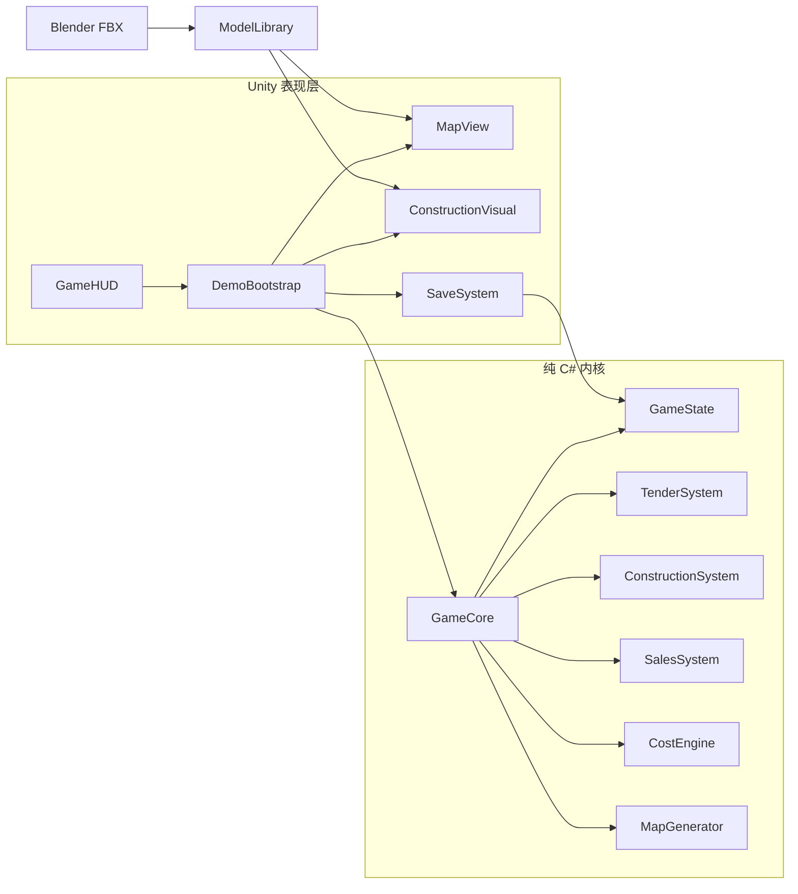

# 代码架构与模块职责

## 1. 总体架构

架构图源文件：`代码架构图.mmd`；同目录提供可缩放的 SVG 与 PNG 预览。



**核心约束：UI 不替代规则层做判定。** `GameHUD` 负责按钮和显示，`DemoBootstrap` 负责组装与计时，`GameCore` 组合经营系统，`GameState` 保存状态。纯 C# 内核不引用 `UnityEngine`，所以测试工程可以脱离 Unity 直接运行。

## 2. 分层与依赖方向

| 层 | 目录 | 可以依赖 | 不应依赖 |
|---|---|---|---|
| 资产生产 | `Tools/Blender`、`Tools/AssetBridge` | Blender / Three.js 工具链 | Unity 运行时逻辑 |
| 经营内核 | `Assets/Scripts/Core` | .NET 基础类型、同层模块 | `UnityEngine`、uGUI、场景对象 |
| Unity 表现 | `Assets/Scripts/Unity` | Core、Unity API、FBX 资源 | 在 UI 内复制经营规则 |
| 编辑器工具 | `Assets/Scripts/Editor` | UnityEditor、资源路径 | 被打包进运行时 |
| 自动化测试 | `Tests` | Core、.NET 8 | Unity 编辑器运行时 |

依赖方向为 **Blender → FBX → Unity 表现层 → GameCore → 核心规则与状态**。存档从 `GameState` 序列化，不序列化 `GameObject`、Mesh、Camera 或 Button。

## 3. 启动与每帧调用顺序

1. Unity 加载空场景 `Main.unity`。
2. `DemoBootstrap.AutoStart()` 检查是否已有实例，没有则创建 `RealEstateDemo`。
3. `Awake()` 读取 `game_config.json`，创建 `GameCore`。
4. `CreateScene()` 创建等距镜头、方向光、`MapView`、`ConstructionVisual` 和 `GameHUD`。
5. `RebuildWorld()` 根据种子生成合批地形、道路、实体和 UI。
6. `Update()` 只在施工或销售阶段按倍率累计时间，并调用 `GameCore.AdvanceDay()`。
7. UI 每 0.25 秒刷新一次；按钮操作后立即刷新。

这种结构让场景文件保持简单，也避免新手因漏拖引用而无法启动。代价是场景结构主要在代码中，而不是编辑器中可视化排版。

## 4. 核心模块职责

| 文件 | 职责 | 关键协作 |
|---|---|---|
| `GameCore.cs` | 新游戏、恢复、重摇、勘测、设计、采购、开工、逐日推进、贷款、评级 | 所有核心系统 |
| `GameState.cs` | 地块、项目、投标、AI、设计和全局状态；净资产计算 | 被各系统共享 |
| `GameEnums.cs` | 阶段、地质、施工阶段、AI 性格、卡牌、销售模式 | 全工程 |
| `GameRandom.cs` | XorShift32；随机状态写入 `GameState` | 投标、销售 |
| `GameConfig.cs` | 初始资金、成本、材料、利率等配置模型 | 成本、内核 |
| `MapGenerator.cs` | 100×100 地形、道路、地块、经营主体；BFS 连通与运距 | 成本、地图表现 |
| `CostEngine.cs` | 可承受地价、队伍报价与工期、材料到场价、售价与全成本 | 地图、配置、状态 |
| `TenderSystem.cs` | 八类卡牌、三类 AI、资金证明、预算锁定、中标与退出 | 随机、状态 |
| `EventSystem.cs` | 碎石、软土、文物、台风、材料涨价 | 勘测、进度、月度结算 |
| `ConstructionSystem.cs` | 开工门槛、每日进度、五阶段、停工 | 成本、事件 |
| `SalesSystem.cs` | 70% 预售、分批/一次性开盘、定价概率与回款 | 成本、随机 |

## 5. Unity 表现模块

| 文件 | 职责 |
|---|---|
| `DemoBootstrap.cs` | 自动启动、场景组装、游戏日计时、重摇、保存与读取协调 |
| `GameHUD.cs` | 1080P 卡通运行时 uGUI；像素对齐、Smooth 中文双字体、逐文本字形预加载、完整锚定滚动区、按 `GamePhase` 创建带真实标题的操作按钮，显示成本、日志和引导 |
| `MapView.cs` | 平坦地表与显式顶点色 Lambert、实心地基、分层道路合批 Mesh、立体地块招牌、街道设施、实体模型与点击转发 |
| `ConstructionVisual.cs` | 按阶段重建卡通施工模型，控制挖机和运输车程序化动画 |
| `CameraRig.cs` | 等距正交镜头、平移、旋转、缩放和聚焦 |
| `ModelLibrary.cs` | 按名称加载 FBX；创建独立 Controller 外层承担世界变换，内层保留 FBX 轴向；保留原颜色和贴图并应用标准 Lambert，不支持时保留导入材质，缺失模型时给出警告与占位模型 |
| `SaveSystem.cs` | 配置读取、单槽 JSON、临时文件替换、版本检查 |
| `DemoEditorTools.cs` | 主场景生成、资源检查、Windows 打包、FBX 导入设置 |

## 6. 核心经营循环

源文件：`核心经营循环.mmd`。

```text
MapPreview
  → Tender
  → SurveyDesign
  → ConstructionPlanning
  → Construction（场地平整 → 桩基 → 主体 → 封顶 → 交付）
  → Sales（70% 起可进入）
  → Settlement
```

施工阶段与销售阶段可以交叠：70% 后开盘，施工继续推进；100% 交付且库存全部售罄才进入正常完成结算。破产或五年结束也可进入结算。

## 7. Blender → Unity 资产流水线

源文件：`Blender到Unity资产流水线.mmd`。

- `build_cartoon_assets.py` 完全用参数化函数创建 20 个精细立体卡通模型，不依赖旧版 GLB。
- 每个资产以 `SM_*` 根节点组织；导出时选择根节点及全部子对象。
- FBX 使用 `Y Up`、`-Z Forward`，保留根节点变换，避免重复轴补偿。
- Unity 编辑器导入器设置 `globalScale = 1`、关闭动画导入。
- `ModelLibrary` 只认 Resources 相对路径和模型名，加载后统一应用 `ToonLit`，表现层不直接读取磁盘 FBX。
- `CartoonRealEstateAssets.blend` 是可编辑源文件；`卡通资产总览.png` 与 `精细模型近景.png` 用于资产验收，不参与经营逻辑。
- 美术替换不改变 Core 的阶段阈值、运输距离或存档字段。

## 8. 存档与随机一致性

`GameState.Version = 1` 是当前存档契约。`SaveSystem` 通过 Unity `JsonUtility` 保存状态；测试使用 .NET `System.Text.Json` 验证同一数据结构可恢复。地图由种子重新生成，动态经营数据来自存档，`RngState` 保证读档后的 AI 和销售随机序列不会重抽。

新增需要持久化的字段时，应同时检查：默认值、旧存档兼容、保存后恢复、恢复后继续运行四项，而不是只确认 JSON 中出现字段。

## 9. 扩展示例：新增一个系统

推荐顺序：

1. 在 `GameEnums.cs` / `GameState.cs` 定义规则和状态。
2. 新建纯 C# 系统，构造时只接收需要的状态、配置或地图。
3. 在 `GameCore.Wire()` 组合，并增加对外操作。
4. 在 `Tests/Program.cs` 先写最小成功与失败断言。
5. 在 `GameHUD` 增加按钮和显示，不复制规则。
6. 如需视觉反馈，再改 `MapView` 或 `ConstructionVisual`。
7. 跑核心测试、静态编译、Unity 冷启动和完整闭环。
